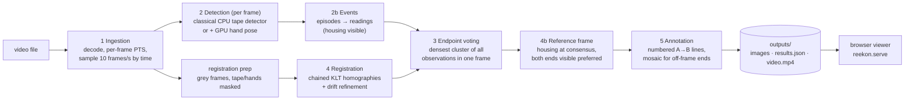

# REEKON Challenge #2 — where was each measurement made?

Input: point-of-view videos of someone measuring cabinets, doors, windows, walls or openings with a tape measure.
Output: for every measurement, an annotated image showing its two endpoints. **A** is the hook end and **B** is where the blade enters the housing. Each image also states how confident the system is, and why.

Everything is automatic, with no manual annotation and no model trained on the footage. Reading the length is out of scope.

## Quick start (Jetson)

```bash
cd ~/Desktop/CV-Challenge-
# 1. put videos in data/inbox/   (git-ignored)
# 2. run the pipeline (classical CPU strategy)
.venv/bin/python -m reekon data/inbox
#    optional: AI-assisted strategy (adds NVIDIA's hand-pose model on the GPU via TensorRT)
python3 -m reekon data/inbox --detector hand-assisted      # system python3: has jetson_inference
# 3. look at the results in a browser
.venv/bin/python -m reekon.serve                            # prints http://<jetson-ip>:8000/
# 4. tests (18 pass; 9 CUDA-parity tests skip because PyTorch CUDA is unavailable here)
.venv/bin/python -m pytest -q
REEKON_FOOTAGE_TESTS=1 .venv/bin/python -m pytest -q -k footage   # ~70 s regression on Cabinet-1.MOV
```

To view the results from a Mac on the same network, open `http://192.168.1.16:8000/`, using the address the server prints. If VS Code Remote is connected, port 8000 is forwarded, so `http://localhost:8000/` also works.

Outputs go to `outputs/<video>/<strategy>/`:
- `measurement_NN.jpg`: one annotated image per measurement.
- `results.json`: endpoints, status, confidence, agreement, notes, every per-frame detection and per-stage timings.
- `video.mp4`: a browser-playable copy that keeps the original timestamps.

**Requirements.** The existing environments are used unchanged: `.venv` (Python 3.11, OpenCV 5, NumPy 2) for the classical strategy and the tests. Two more pieces are needed:
- `ffmpeg`/`ffprobe` on the PATH, for the browser video copy and for checking timestamps.
- JetPack's `jetson-inference` with the `Pose-ResNet18-Hand` model under `~/jetson-inference/data`, but only for `--detector hand-assisted`.

## Results on `Cabinet-1.MOV` (the only footage provided)

The video is 32.7 s, 1552×2064 HEVC. It is variable-frame-rate: it declares 120 fps but averages 30 fps. The pipeline found **4 measurements**. I checked every image by eye; that check was used only for evaluation and is not part of the pipeline.

| # | Time | What it is (visual check) | A hook | B housing | Image |
|---|---|---|---|---|---|
| 1 | 3.7–9.1 s | Right door height: top edge (under the glass) → bottom edge, where the green laser line is | seen in reference frame, 22/51 frames agree | seen, 25/54 agree | `outputs/Cabinet-1/classical/measurement_01.jpg` |
| 2 | 10.7–13.3 s | Left door height | seen, 21/35 | seen, 10/26 | `…/measurement_02.jpg` |
| 3 | 16.3–21.2 s | Width: cabinet left edge → gap between the doors | mapped from other frames, 11/41 | seen, 42/50 | `…/measurement_03.jpg` |
| 4 | 23.3–30.3 s | Width: cabinet left edge → cabinet right edge | mapped from other frames, 17/21 | seen, 58/68 | `…/measurement_04.jpg` |

All four are correct by visual inspection. The two strategies found the same four measurements.

During measurements 3 and 4 the hook is never in the same frame as the housing. Each of those images is therefore a registered mosaic: the frame where the hook was seen is warped, dimmed, around the reference frame.

Accuracy is judged only by eye on this one video. There is no labelled ground truth, so no pixel-error figure is claimed. The opt-in regression test locks in the count, the both-endpoints result and the orientation.

## Architecture



| Stage | Module | What it does |
|---|---|---|
| 1 Ingestion | `reekon/video.py` | Decodes with OpenCV and timestamps every frame with its presentation timestamp, checked against ffprobe for all 981 frames. Samples by time, never by index ÷ fps, because this footage's header rate is wrong by 4×. |
| 2 Detection | `reekon/detect.py`, `reekon/hands.py` | Finds a dark strip relative to the frame's brightness, cleans it up, takes the longest blade-width shape and grows it along its line. The width profile along the line separates the narrow blade from the wide housing. Each end is flagged as visible or cut off by the frame edge. Confidence comes from length, tick-mark texture, straightness and coverage. |
| 2b Events | `reekon/events.py` | An *episode* is continuous tape visibility in one direction. A *reading* (one measurement) is a stretch of at least 0.8 s with the housing visible. Readings at the same endpoints are merged. |
| 3 Endpoints | `reekon/events.py` | Every observation of an endpoint is mapped into the reference frame, and the estimate is the densest cluster. Hook sightings must come from between the neighbouring readings and lie on the visible tape line; this rejects the other door's hook. Too little agreement gives `missing`. |
| 4 Registration | `reekon/register.py` | Tracks corners frame to frame (forward-backward checked), fits a RANSAC homography per step and chains them, then refines to remove drift. The reference frame is the best-ranked frame whose own housing detection matches the consensus. |
| 5 Annotation | `reekon/annotate.py` | Draws a numbered A→B line. A filled marker means seen in this frame; a hollow marker with a dashed ring means mapped from other frames, with the ring showing the spread. Endpoints outside the frame get a dimmed registered mosaic. The caption sits above the image and states status, agreement and corrections. |
| Viewer | `viewer/index.html`, `reekon/serve.py` | Shows the video with a per-sample detection overlay, a timeline, measurement cards, the images and performance tables. The server exposes only `viewer/`, `outputs/` and `results/`, and supports HTTP Range requests, which Safari needs to play video. |

The detection strategy is chosen at run time (`--detector classical | hand-assisted`); the rest of the pipeline is shared.

## Design choices, and why

- **Classical CV first, no training.** In this footage the blade is a long, straight, dark strip with bright ticks, attached to a much wider housing. That is a strong geometric signal, and there was one video with no labels. A trained detector would need labelled tape footage that doesn't exist here, and it would have to be trained on the test video itself.
- **Endpoints from many frames, not one.** A PoV camera rarely holds both ends in view. Voting across frames tolerates blur, the housing still moving into place and single-frame errors.
- **Optical-flow chaining over descriptor matching.** This was measured. SIFT/ORB matching between frames 2–4 s apart kept 0–17 RANSAC inliers on the white, wide-angle footage. Chained Lucas-Kanade steps keep 12–39 inliers per step.
- **Straight-blade prior.** The blade is straight and visible in the reference frame, so a hook mapped in from another frame must lie on its extension. Registration error over big pans is mostly perpendicular to the tape and measured up to ~290 px; that component is removed. The other door's hook (640 px off) is rejected. Every correction is recorded in the notes and the caption.
- **Never fabricate.** Statuses are `observed`, `registered` or `missing`. A missing hook is not drawn. The viewer greys out samples that weren't analysed. GPU numbers are shown only where they were measured.
- **The housing end is the blade's entry into the housing.** On this digital tape measure, the green laser line marks that point, and the detected B markers land on it.

## Performance (measured on this Jetson Orin Nano, Cabinet-1.MOV, 327 samples)

| Stage | classical (CPU) | hand-assisted (CPU + TensorRT GPU) |
|---|---:|---:|
| decode + sample | 22.8 s | 4.7 s |
| detect | 18.2 s (55.5 ms/sample) | 42.6 s (130.2 ms/sample, includes the hand model) |
| registration prep | 4.6 s | 7.8 s |
| frame cache (JPEG) | 7.7 s | 9.1 s |
| events + endpoints + registration | 15.1 s | 21.2 s |
| annotate | 0.6 s | 0.7 s |
| **pipeline wall time** | **69.1 s** | **93.8 s** |
| measurements found | 4 | 4 |
| browser video encode (not part of the pipeline) | 21.1 s | 20.9 s |

How to read these numbers:
- **The comparison is confounded by environment.** The GPU model is only available to the system Python (OpenCV 4.8 / NumPy 1.26), while the classical run used `.venv` (OpenCV 5.0 / NumPy 2.4). That is why the two runs detected tape in 264 vs 275 samples.
- **Stage times overlap.** FFmpeg decodes on background threads while detection runs, so per-stage times are not independent. Raw decode is 9.2 ms/frame under OpenCV 5.0 and 14.7 ms/frame under 4.8. Compare the totals, not the decode row.
- **The GPU strategy gains nothing here.** It costs about +75 ms per sample and found the same 4 measurements. Confidence went up for #2 (0.58 → 0.84) and was 0.01–0.03 lower for the other three.
- **PyTorch CUDA does not work in this environment.** Its CUDA 13.2 build doesn't match the JetPack 6 driver (see `results/cuda-diagnostics.log`). So no PyTorch GPU path is timed, and the Phase 1 `cvbench` GPU cases remain "unavailable" ([docs/benchmark.md](docs/benchmark.md)).

## Limitations

- **One video.** Tolerances such as cluster radius, tape-line tolerance and reading length were tuned and checked on `Cabinet-1.MOV` only. Doors, windows, walls and openings were not seen.
- **Tape appearance.** The detector assumes a dark blade with bright markings and a wider housing. A yellow or white blade needs a different mask (see below).
- **Lens and parallax.** Homographies ignore the wide-angle distortion and assume a planar scene. Hooks mapped across large pans are approximate. The images say so, and the ±spread ring shows it.
- **Fixed hook within a reading.** If the hook slides during a reading, the result is the most-agreed position, with alternatives listed in `results.json`.
- **Endpoint B** is where the blade enters the housing, not the back of the housing. Some tape measures read from the back.
- **The browser video was not played back here.** WebKitGTK on the Jetson could not load any `<video>`, even a bare tag, in an offscreen session. Range serving, the H.264 file and its timestamps were verified separately (within 3.3 ms of the source). The page itself rendered and ran without errors in WebKit.

## Alternatives considered

| Option | Outcome |
|---|---|
| Colour (yellow) blade mask | Rejected after seeing the footage: the blade is black with yellow numbers. |
| SIFT / ORB matching for registration | Measured 0–17 inliers across 2–4 s; replaced by chained KLT. |
| Hand-rolled weighted-PCA line fit (for speed) | ~2° bias on long blades broke detection; kept `cv2.fitLine` on a 3,000-point subsample (120 → 63 ms/frame). |
| "Hand at an end ⇒ that end is the housing" rule | Fired on 5 of 66 frames, all wrong (hands press the hook in place); replaced by "hand at the hook end ⇒ more confidence". |
| Training or fine-tuning a detector (e.g. YOLO, available in `.venv`) | Not done: no labelled data, and the classical detector already finds every reading here. It's the next step if new footage breaks the classical masks. |

## AI usage

- **In the pipeline:** NVIDIA's pretrained Pose-ResNet18-Hand (jetson-inference / TensorRT) in the optional hand-assisted strategy. It is used as-is, not trained or fine-tuned. Everything else is classical CV.
- **In development:** this code, the tests and this README were written with Claude Code (an AI coding assistant) working on the Jetson. It inspected the footage frame by frame, ran every experiment above and checked every output image. A person should still review the visual judgements.

## With two more weeks

1. **More footage.** Run on doors, windows, walls and openings with different tape types; add a small hand-checked endpoint set to report pixel error instead of visual checks.
2. **Lens self-calibration from the blade.** The blade is physically straight, so its image curvature across many frames fixes a one-parameter radial distortion. Registering undistorted points would shrink the 200–290 px corrections.
3. **Laser-line refinement of B.** Detect the green line where it crosses the blade for a sub-blade-width estimate of endpoint B.
4. **Learned blade/hook/housing detector, if needed.** Train or fine-tune a small YOLO segmentation model on frames auto-labelled by the classical detector (high-confidence frames only), then compare the two on held-out videos.
5. **Speed.** Hardware HEVC decoding (NVDEC through GStreamer), fewer full-resolution JPEG caches, and running detection only around tape episodes. The bottlenecks today are decode, detection and registration.
6. **Read the length (stretch goal).** OCR the housing's LCD at the reference frame.

## Repository layout

```
reekon/        measurement pipeline (video, detect, hands, register, events, annotate, pipeline, serve)
viewer/        browser results viewer (static HTML/JS, no external dependencies)
tools/         footage inspection: contact sheets, live hand-pose playback
tests/         pytest suite (synthetic + opt-in real-footage regression)
cvbench/       Phase 1 CPU/GPU preprocessing benchmark  → docs/benchmark.md
results/       Phase 1 benchmark results and CUDA diagnostics
outputs/       pipeline outputs for the provided footage (browser video copies are git-ignored)
data/inbox/    drop folder for input videos (git-ignored)
```
