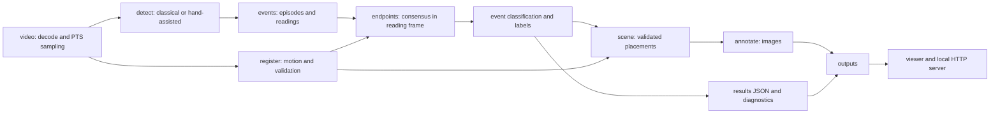

# REEKON Challenge #2 — where was each measurement made?

Locate tape-measure events in point-of-view video and draw numbered **A** (hook) to **B**
(blade entry into housing) lines on scene and reading-frame images. Events remain `validated`,
`uncertain` or `rejected`; missing endpoints are reported explicitly. Reading physical lengths is
out of scope. No models are trained and no video-specific endpoints or timestamps are supplied.

## Run and view

Core: Python 3.9+, NumPy, OpenCV and pytest; FFmpeg/ffprobe support browser proxies and timestamp
checks. Recorded CPU execution uses Python 3.11 / OpenCV 5.0 / NumPy 2.4.6. From the repository root:

```bash
python3.11 -m venv .venv
.venv/bin/pip install -r requirements.txt
.venv/bin/python -m pytest -q
.venv/bin/python -m reekon.serve --outputs outputs/accuracy-final --host 127.0.0.1 --port 8000
# Open http://localhost:8000/
```

To process your own footage, copy it into `data/inbox/` (ignored), then run
`.venv/bin/python -m reekon data/inbox --out outputs/new-run`. Use a separate output folder to
preserve existing evidence, then pass that folder to
`reekon.serve --outputs /path/to/new-results`. `--sample-fps` defaults to 10, and `--no-proxy` skips
H.264 encoding. Without FFmpeg the image/JSON pipeline still runs. For LAN access use
`--host 0.0.0.0`; the server exposes the viewer, selected outputs and benchmark results.

Two independently executable strategies share the classical blade detector:

```bash
.venv/bin/python -m reekon data/inbox --out outputs/new-run --detector classical
.venv-jetson/bin/python -m reekon data/inbox --out outputs/new-run --detector hand-assisted
```

Classical uses CPU OpenCV/NumPy only. Hand-assisted adds NVIDIA's pretrained
Pose-ResNet18-Hand through JetPack `jetson_inference` / TensorRT; hand proximity boosts hook
confidence. It does not replace the blade detector. No Torch is imported by either strategy.
The recorded GPU environment inherits Python 3.10, OpenCV 4.8, NumPy 1.26 and JetPack's existing
CUDA 12.2 / TensorRT 8.6.2 packages. Do not replace them with incompatible PyPI CUDA builds.
See [complete stack and environment setup](docs/environments.md).

## Architecture and repository



`reekon/pipeline.py` orchestrates the stages; `config.py` contains shared defaults.
[Architecture](docs/architecture.md) explains responsibilities, coordinate systems, timestamps and
interfaces. `viewer/` is static HTML/CSS/JavaScript, with no frontend dependencies. `tools/` holds
inspection utilities. `tests/` holds synthetic, optional CUDA and opt-in footage checks.
`outputs/` preserves evaluation JSON and images; raw videos, proxies, diagnostics, weights,
environments and caches are ignored. Historical benchmark evidence lives in `results/`.

`cvbench/` is a separate NumPy/OpenCV versus PyTorch CUDA preprocessing benchmark:

```bash
.venv/bin/python -m cvbench --backend cpu --output /tmp/cpu-benchmark.json
.venv-jetson/bin/python -m cvbench --backend both --output /tmp/cuda-benchmark.json
REEKON_FOOTAGE_TESTS=1 .venv/bin/python -m pytest -q -k footage
```

Only the optional benchmark uses PyTorch (`requirements-gpu.txt`); the hand strategy uses the
existing JetPack runtime. See [benchmark methodology](docs/benchmark.md) and
[measured evaluation](docs/evaluation.md) for recorded versions, timing and provenance.

## Ten-video evaluation and limitations

The final classical runs in `outputs/accuracy-final/` contain **35 candidates: 12 algorithm-validated,
22 uncertain and 1 rejected** across all ten videos. Validated counts are Cabinet-1 **4**,
Countertop-1 **2**, Deck-1 **5**, Kitchen Sink **1**, and **0** for Deck-2, Door-1, Frame Pipes-1,
Kitchen Cabinets, Large Window and Outdoor_Pipes. The **five originally zero-result videos** remain
at zero; Deck-2's false validation was demoted, making **six zero-result videos in the final run**.
Validation is an algorithm classification, not ground-truth correctness: partial/ambiguous Deck-1
endpoints and imprecise Countertop-1 housing placement remain.

The original 14 indexed classical/hand-assisted runs, including the earlier 14 classical validated
measurements, remain at their original paths and in `outputs/index.json`. The separate final index
contains ten classical runs. Use the server's `--outputs` argument to select which snapshot to view.

Known limitations include blade-less measurements (Large Window), missing or occluded hooks,
over-exposed hands, beige surfaces mistaken for skin, foreshortening, parallax and lens distortion.
Clear scene registration often fails safely to the reading frame. Three historical runs predate
labels. See the [full ten-video evaluation, limitations and original comparisons](docs/evaluation.md).

Thresholds were calibrated using the first four videos, including 24 selected frames and observed
registration successes/failures; the remaining six were not retuned. There is no held-out labelled
accuracy benchmark. Original development used Claude Code; this refinement used OpenAI Codex.
The only learned production component is the optional pretrained hand model; YOLO was prepared
as an experiment but not run. [AI usage and tuning disclosure](docs/evaluation.md#ai-usage-and-tuning-disclosure)
retains the original evaluation's visual-judgement provenance.

## Final accuracy pass (2026-11-07)

The final ten-video run has **35 candidates: 12 validated, 22 uncertain and 1 rejected**.
The five originally zero-result videos remain at zero; Deck-2 also has zero after its false
validation was demoted. No safe recall gain was demonstrated.

Fresh classical results live separately in `outputs/accuracy-final/`; the original outputs and
benchmark evidence are preserved. Housing-entry localization now handles split housing masks,
checks local blade contrast, and excludes unsupported entries from endpoint voting and reference
selection. Cabinet-1 retains four measurements. Deck-2's known bad validated line is now an
uncertain candidate with no invented housing endpoint. Adjacent Deck-1 readings of one continuous
placement merge into one event.

A broader seed search was reverted after introducing a hand-as-housing false validation on
Deck-1. Missing/occluded hooks, fragmented tape detections, imprecise housing placement and
blade-less measuring remain limitations. No reliable new clean scene correspondence was forced.
See the [final diagnosis, before/after counts, visual review and timings](docs/evaluation.md#final-accuracy-pass-2026-11-07).

Validation: 39 CPU tests passed, 10 skipped; nine focused endpoint tests also passed with the
existing Jetson/OpenCV 4.8 environment. No packages, CUDA settings or models were changed.
View the separate results with `.venv/bin/python -m reekon.serve --outputs outputs/accuracy-final`.
