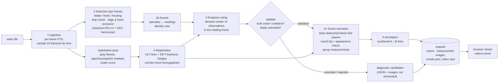

# REEKON Challenge #2 — where was each measurement made?

Input: point-of-view videos of someone measuring cabinets, countertops, decks, doors, windows, walls or openings with a tape measure.
Output: scene images with numbered measurement lines on the measured surfaces, plus one image per confirmed measurement. **A** is the hook end and **B** is where the blade enters the housing. Each image states how confident the system is, and why.

Everything is automatic: no manual annotation, no hard-coded coordinates or timestamps, and no model trained on the footage. Reading the length is out of scope.

## Implemented features

- **Video ingestion:** timestamps every frame with its presentation timestamp, so variable-frame-rate phone video is handled correctly. Frames are sampled by time.
- **Per-frame tape detection:** finds the blade, the hook end and the housing end.
  - It rejects dark lines that aren't tapes, such as railings, vegetation edges, poles and shadows.
  - It never takes a blade end that runs into the frame edge, or disappears behind a hand, for the hook.
- **Measurement events:** episodes and readings, with hook/housing labels kept consistent over time. Each event is `validated`, `uncertain` or `rejected`, with reasons. Only validated events are presented as measurements.
- **Endpoint localisation:** votes across many frames and reports confidence, agreement and spread. An endpoint without enough agreement is `missing`, never invented.
- **Scene registration:** measured points are carried between frames using features near the measured object, bridging fast camera motion with keyframe matching. A mapping is accepted only if it passes three checks:
  - a round trip through independent reverse links;
  - the points land inside the target frame;
  - an appearance check confirms the same surface in both frames.
- **Scene images:** validated measurements are drawn on the least obstructed frame that maps reliably, grouped when several fit one frame. Otherwise the reading frame is used.
- **Browser viewer:** scene images, validated measurements vs unconfirmed candidates, diagnostic images, the video with a per-frame overlay, a timeline, and classical vs AI-assisted results.
- **Measurement:** per-stage timings in every `results.json`, and a measured CPU vs CUDA benchmark (`cvbench`).
- **Tools and tests:** footage inspection tools and a pytest suite (synthetic tests plus an opt-in regression on real footage).

## Tech stack (as run and tested)

| Component | Version / detail |
|---|---|
| Hardware | NVIDIA Jetson Orin Nano Developer Kit (8 GB), JetPack 6 / L4T R36.3 (CUDA 12.2, cuDNN 8.9, TensorRT 8.6.2) |
| Main environment (`.venv`) | Python 3.11, OpenCV 5.0.0, NumPy 2.4.6, pytest. Used for the pipeline, viewer server and tests. Its PyTorch 2.15 is a CUDA 13.2 build and cannot use this JetPack's GPU |
| System `python3` (JetPack) | Python 3.10.12, OpenCV 4.8.0, NumPy 1.26.4, **PyTorch 2.1.0 with CUDA 12.2 (GPU works)**, `jetson-inference` with TensorRT running NVIDIA's pretrained Pose-ResNet18-Hand |
| GPU environment (`.venv-jetson`) | A venv that inherits the system packages above unchanged, plus `pytest` 9.2.0 and `psutil` 7.2.2 installed into the venv only. Used for TensorRT inference, the CPU/GPU benchmark and the CUDA parity tests |
| Video tools | FFmpeg / ffprobe 4.4.2 |
| Viewer | Static HTML/CSS/JavaScript (no frameworks or CDNs) served by Python's `http.server` with added Range support |

## Quick start

### Setup (core pipeline: Python 3.9+, NumPy and OpenCV; verified from a fresh clone on the Jetson, Linux aarch64, Python 3.11 — other platforms untested)

```bash
git clone https://github.com/NJROzzy/CV-Challenge-.git && cd CV-Challenge-
git checkout feature/challenge-2
python3 -m venv .venv            # on this Jetson use python3.11: JetPack's python3.10 lacks ensurepip
.venv/bin/pip install -r requirements.txt     # numpy, opencv-python, pytest - no PyTorch, no CUDA
.venv/bin/python -m pytest -q                 # synthetic tests; no videos needed
mkdir -p data/inbox && cp /path/to/your/videos/*.MOV data/inbox/   # raw videos are not in git
.venv/bin/python -m reekon data/inbox         # annotated images -> outputs/<video>/classical/
.venv/bin/python -m reekon.serve              # browse the results at http://localhost:8000/
```

`ffmpeg`/`ffprobe` on the PATH are optional. They make the browser copy of each video and check timestamps; without them the pipeline still runs, and `--no-proxy` skips the browser video. PyTorch is only needed for the optional GPU benchmark (`requirements-gpu.txt`); the measurement pipeline never imports it.

### Which Python environment to use (on the Jetson)

| Task | Environment | Why |
|---|---|---|
| Classical measurement pipeline, viewer server, tests | `.venv` | The pipeline is OpenCV/NumPy on the CPU and needs no CUDA |
| AI-assisted strategy (TensorRT hand pose) | `.venv-jetson` | Needs JetPack's `jetson_inference`/TensorRT, which only the system Python provides |
| CPU vs GPU benchmark, CUDA parity tests | `.venv-jetson` | Needs a PyTorch that can use this JetPack's GPU: the system PyTorch 2.1 / CUDA 12.2 |

The `.venv` PyTorch (2.15, built for CUDA 13.2) cannot initialise CUDA on JetPack 6's CUDA 12.2 driver, which is why there are two environments. Neither environment's packages were replaced.

Set up `.venv-jetson` (once, about a minute; no system changes):

```bash
cd ~/Desktop/CV-Challenge-
# JetPack's Python lacks ensurepip (python3.10-venv), so create the venv without its own pip and use
# the system pip from inside it; installs go into the venv only.
python3 -m venv --system-site-packages --without-pip .venv-jetson
.venv-jetson/bin/python -m pip install pytest psutil
.venv-jetson/bin/python -c "import torch; print(torch.__version__, torch.cuda.is_available())"   # 2.1.0 True
```

### Running

```bash
cd ~/Desktop/CV-Challenge-
# 1. put videos in data/inbox/   (git-ignored)
# 2. run the pipeline (classical CPU strategy)
.venv/bin/python -m reekon data/inbox
#    optional: AI-assisted strategy (adds NVIDIA's hand-pose model on the GPU via TensorRT)
.venv-jetson/bin/python -m reekon data/inbox --detector hand-assisted
# 3. look at the results in a browser
.venv/bin/python -m reekon.serve                            # prints http://<jetson-ip>:8000/
# 4. tests: in .venv 25 pass and the 9 CUDA-parity tests skip; in .venv-jetson all 34 pass (CUDA tests run)
.venv/bin/python -m pytest -q
.venv-jetson/bin/python -m pytest -q
REEKON_FOOTAGE_TESTS=1 .venv/bin/python -m pytest -q -k footage   # ~80 s regression on Cabinet-1.MOV
# 5. CPU vs GPU preprocessing benchmark (needs the CUDA-capable PyTorch)
.venv-jetson/bin/python -m cvbench --backend both --output results/gpu_venv_jetson.json
```

To view the results from a Mac on the same network, open the address the server prints (here `http://192.168.1.16:8000/`). With VS Code Remote, `http://localhost:8000/` also works through port forwarding.

Outputs go to `outputs/<video>/<strategy>/`:

| File | Contents |
|---|---|
| `scene_NN.jpg` | Scene images: one or more measurements drawn on another frame of the scene |
| `measurement_NN.jpg` | One image per validated measurement, on its reading frame |
| `diagnostics/candidate_NN.jpg` | Unconfirmed candidates, with the reasons in the caption. Git-ignored and regenerated each run |
| `results.json` | Everything above, plus every per-frame detection, the scene-registration log and per-stage timings |
| `video.mp4` | Browser copy of the video, with the original timestamps. Git-ignored |

## Results on all ten videos

I judged each image by eye. That check is used only for this evaluation and is not part of the pipeline. Nothing here is a quantitative accuracy figure: there's no ground truth. All ten were run with the classical strategy at the default settings (10 samples/s). The detection thresholds were set on the first four videos and were **not** retuned for the other six.

### Overview

| Video | Length | Tape samples | Candidate events | Validated | Uncertain / rejected | Outcome |
|---|---:|---:|---:|---:|---:|---|
| Cabinet-1 | 33 s | 253 of 327 | 4 | 4 | 0 / 0 | ✅ 4 correct |
| Countertop-1 | 97 s | 439 of 966 | 8 | 2 | 6 / 0 | ✅ 2 correct, ⚠️ 6 uncertain |
| Deck-1 | 75 s | 386 of 749 | 16 | 6 | 10 / 0 | ⚠️ 3 plausible, 2 partial, 1 uncertain; 10 uncertain |
| Deck-2 | 20 s | 61 of 199 | 3 | 1 | 2 / 0 | ❌ the 1 validated is wrong; 2 uncertain |
| Door-1 | 35 s | 17 of 351 | 0 | 0 | 0 / 0 | ❌ missed: no measurement event detected |
| Frame Pipes-1 | 15 s | 90 of 155 | 1 | 0 | 1 / 0 | ⚠️ 1 uncertain (hook not localised) |
| Kitchen Cabinets | 180 s | 242 of 1797 | 2 | 0 | 1 / 1 | ⚠️ 1 uncertain, 1 rejected (no endpoint) |
| Kitchen Sink | 39 s | 104 of 387 | 1 | 1 | 0 / 0 | ✅ 1 plausible |
| Large Window | 57 s | 21 of 572 | 0 | 0 | 0 / 0 | ❌ none: the measuring device is held against the framing with no extended blade, so this detector has nothing to find |
| Outdoor_Pipes | 26 s | 44 of 259 | 1 | 0 | 1 / 0 | ⚠️ 1 uncertain (hook not localised) |
| **Total** | | | **36** | **14** | **21 / 1** | |

Key: ✅ validated and checked correct · ⚠️ uncertain, or validated but not clearly right · ❌ wrong or nothing found. Only validated measurements are drawn as measurements. Uncertain and rejected candidates are kept in `results.json`, and in `diagnostics/`, with their reasons.

**Width/height labels.** Each validated measurement is labelled height, width or diagonal from the direction of its line in the reading frame. A left/right or top/bottom position is added only when a validated mapping lets two measurements of the same type be compared. The labels are present for Cabinet-1 (2 heights, 2 widths) and Countertop-1 (2 diagonals). Deck-1, Deck-2 and Kitchen Sink were processed before labelling was added and weren't rerun, so their validated measurements have no labels yet. The other five videos have no validated measurements to label.

### First four videos, in detail

| Video | Candidate events | Validated | Visual check of validated | Unconfirmed candidates | Scene images (registered views) | Compared with the previous pipeline |
|---|---:|---:|---|---|---:|---|
| Cabinet-1 (33 s, indoor cabinets) | 4 | 4 | 4 correct: both door heights and both widths | none | 4 (2) | Same 4 correct measurements, no regression |
| Countertop-1 (97 s, marble counters) | 8 | 2 | 2 correct diagonal counter measurements | 6 uncertain: 4 with the housing end right but the hook not localised, 1 low-confidence, 1 correct measurement now unconfirmed (see regression) | 2 (1) | The false "carrying" event is gone. **Regression:** the 31–32 s measurement, correct before, is now uncertain |
| Deck-1 (75 s, outdoor deck) | 16 | 6 | #3, #5, #6 plausible (vertical rail-to-rail); #2, #4 partial (hook placed where the blade goes behind over-exposed fingers); #1 uncertain | 10 uncertain, mostly the housing end right and the hook not localised | 5 (4), including #4 and #5 grouped on one frame | No longer confirms the railing-gap false line, the swapped-ends case or the frame-edge hooks |
| Deck-2 (20 s, outdoor deck) | 3 | 1 | **Wrong:** A at the frame edge, B on the housing body | 2 uncertain | 1 (1) | The vegetation-edge and pole false events are gone; the remaining confirmed one is still wrong |

### Six added videos, in detail

| Video | Validated: visual check | Unconfirmed candidates | Scene images (registered views) | Why so few |
|---|---|---|---:|---|
| Door-1 (35 s) | none | none | 0 | The tape was seen in only 17 samples, too few for a reading |
| Frame Pipes-1 (15 s) | none | 1 uncertain, 6.1–14.3 s: hook end not localised | 0 | The blade was seen often, but its far end was never confirmed |
| Kitchen Cabinets (180 s) | none | 1 rejected, 101.2–102.1 s: no endpoint localised; 1 uncertain, 159.0–160.3 s: hook not localised | 0 | The tape was visible in only 13% of samples over a long video |
| Kitchen Sink (39 s) | #1 plausible: along the top edge of a cabinet carcass, from back to front. A is close to the left edge of the frame | none | 1 (1) | n/a |
| Large Window (57 s) | none | none | 0 | 21 blade-like detections in short bursts of up to 1 s, mostly without the housing. In the readings the device is pressed against the framing with its display showing and no blade extended. This is outside what a blade detector can measure |
| Outdoor_Pipes (26 s) | none | 1 uncertain, 6.1–7.0 s: hook not localised | 0 | Few tape samples (44 of 259) |

**Scene images, honestly:**
- **What they are:** the "registered views" are nearby frames chosen for less obstruction. They still show the tape and hands.
- **What was rejected:** frames that show the measured object unobstructed (approach frames) were rejected by the reliability checks on this footage. The scene-registration log in each `results.json` breaks down why: broken chains during fast head motion, round-trip error, endpoints out of view, or the appearance check. I'd rather show the reading frame than draw a line in the wrong place.
- **What the appearance check caught:** before it was added, one deck measurement was drawn on the beach instead of the railing. That mapping had passed the round-trip check, because the error was consistent in both directions.

**Previous vs new pipeline, in short:** fewer confirmed measurements, but far fewer wrong ones presented as confirmed. Everything rejected is kept as a diagnostic candidate with its reason.

## Architecture



| Stage | Module | What it does |
|---|---|---|
| 1 Ingestion | `reekon/video.py` | Decodes with OpenCV, timestamps every frame with its presentation timestamp (checked against ffprobe) and samples by time. Cabinet-1 declares 120 fps but averages 30 fps. |
| 2 Detection | `reekon/detect.py`, `reekon/hands.py` | See the detection rules below this table. |
| 2b Events | `reekon/events.py` | An episode is continuous tape visibility in one direction; a reading is at least 0.8 s with the housing visible. For hook/housing identity, consecutive frames are linked by whether their ends keep or swap labels, and each chain's orientation is the majority vote of frames that actually saw the housing. |
| 3 Endpoints | `reekon/events.py` | Votes observations into the reading frame. Hook sightings must lie on the visible tape line. Validation: both ends present, confidence ≥ 0.4, and median blade length ≥ 20% of the frame (otherwise the tape is being carried or repositioned). |
| 4 Registration | `reekon/register.py` | Lucas-Kanade tracks between consecutive samples. When those fail, SIFT keyframe bridges (≥ 25 inliers) span up to 1.5 s. Points move by homographies fitted only to features in a corridor around the measured segment. `map_validated` adds a round trip within 2% of the diagonal, an inside-frame check, and a masked-patch NCC ≥ 0.5 at every checkable endpoint. |
| 4c Scenes | `reekon/scene.py` | Ranks nearby frames by sharpness and obstruction, maps validated measurements with `map_validated`, and greedily groups them. Falls back to the reading frame. Logs every rejection reason. |
| 5 Annotation | `reekon/annotate.py` | Numbered A→B lines. A filled marker means seen in that frame; hollow with a dashed ring means mapped there, with the ring showing spread or round-trip error. Candidates are captioned "NOT a confirmed measurement" with their reasons. |
| Viewer | `viewer/index.html`, `reekon/serve.py` | Serves only `viewer/`, `outputs/` and `results/`, with HTTP Range support (Safari needs it for video). |

Detection rules (stage 2), in the order they apply:
- **Find the tape:** look for a dark strip relative to the frame's brightness and grow the blade along its line. The width profile along the line separates the narrow blade from the wide housing.
- **Strip check:** keep it only if it is darker than the surface on both sides over at least 40% of its length, and has at least 0.9 bright/dark tick alternations per blade width.
- **When an end counts as seen:** only if the blade doesn't run into the frame edge (more than 1.1 blade widths from it, measured along the blade), and the area beyond the end is not mostly skin or sleeve.

## Design choices, and why

- **Classical CV first, no training.** The blade is a long, straight, dark strip with bright ticks, attached to a wider housing. That's a strong geometric signal, and there are no labelled tape videos.
- **Measured thresholds, not guessed ones.** The strip check and the frame-edge rule were set from true and false detections on 24 frames from all four videos. The appearance threshold was set from correct mappings (NCC 0.97–1.0) against wrong-depth mappings (0.20–0.31). The margins are thin, and the code comments record them.
- **One homography can't cover several depths.** Each link's transform is fitted near the measured object, and appearance is checked afterwards. The round trip alone was not enough: it passed a consistently wrong mapping.
- **Never present a guess as a measurement.** Endpoints are `observed`, `registered` or `missing`. Events are `validated`, `uncertain` or `rejected`, and reasons are kept. Unreliable transforms fall back to the reading frame.

## Performance

### Pipeline, per video (measured on this Jetson; wall-clock seconds; browser video encode excluded)

| Video | Strategy | Decode | Detect | Registration prep | Frame cache | Events + endpoints | Scene registration | Annotate | **Total** |
|---|---|---:|---:|---:|---:|---:|---:|---:|---:|
| Cabinet-1 | classical | 23.1 | 19.0 | 4.9 | 7.7 | 14.9 | 10.9 | 0.7 | **81.2** |
| Cabinet-1 | hand-assisted | 7.0 | 45.5 | 8.0 | 9.1 | 19.5 | 12.7 | 1.1 | **124.3** |
| Countertop-1 | classical | 55.2 | 40.1 | 13.4 | 18.5 | 17.1 | 7.9 | 0.4 | **152.7** |
| Countertop-1 | hand-assisted | 13.7 | 97.1 | 20.9 | 21.8 | 21.0 | 19.3 | 0.6 | **205.4** |
| Deck-1 | classical | 44.1 | 36.0 | 10.6 | 15.8 | 21.4 | 36.9 | 1.3 | **166.1** |
| Deck-1 | hand-assisted | 10.9 | 86.2 | 16.1 | 18.8 | 27.8 | 31.1 | 1.2 | **206.4** |
| Deck-2 | classical | 12.6 | 13.5 | 2.8 | 4.1 | 3.7 | 11.9 | 0.2 | **48.8** |
| Deck-2 | hand-assisted | 2.9 | 32.9 | 4.7 | 4.9 | 3.6 | 18.9 | 0.2 | **79.2** |

How to read these numbers:
- **Stage times overlap.** FFmpeg decodes on background threads while detection runs. The two strategies also run in different environments (OpenCV 5.0 vs 4.8). Compare totals.
- **The hand-assisted strategy is 24–62% slower and doesn't improve correctness here:**
  - Cabinet-1: same 4 measurements.
  - Countertop-1: 3 validated; the third is a doubtful short-tape event.
  - Deck-1: 4 validated against 6.
  - Deck-2: 2 validated; one I can't confirm, the other has the same flaw as the classical run.

### Classical vs AI-assisted (algorithm comparison, separate from hardware)

| Video | Classical: tape samples / validated / unconfirmed | Hand-assisted: tape samples / validated / unconfirmed |
|---|---|---|
| Cabinet-1 | 253 of 327 / 4 / 0 | 262 of 327 / 4 / 0 |
| Countertop-1 | 439 of 966 / 2 / 6 | 449 of 966 / 3 / 4 |
| Deck-1 | 386 of 749 / 6 / 10 | 405 of 749 / 4 / 9 |
| Deck-2 | 61 of 199 / 1 / 2 | 80 of 199 / 2 / 0 |

### CPU vs CUDA preprocessing (`cvbench`, measured: `results/gpu_system_python.json`)

This is resize, grayscale and Gaussian blur on synthetic frames, not the measurement pipeline. It was run with JetPack's system PyTorch 2.1 / CUDA 12.2, and the CPU path is OpenCV 4.8.

| Input, batch | CPU median ms | GPU median ms | End-to-end speedup | Stage speedup (resize / gray / blur) |
|---|---:|---:|---:|---|
| 480p, 1 | 3.17 | 5.00 | 0.63× | 3.4 / 0.6 / 0.1 |
| 480p, 8 | 25.30 | 15.82 | 1.60× | 12.2 / 4.2 / 0.2 |
| 720p, 8 | 98.59 | 40.23 | 2.45× | 19.1 / 6.6 / 0.3 |
| 1080p, 1 | 20.48 | 14.27 | 1.44× | 8.2 / 4.2 / 0.2 |
| 1080p, 8 | 218.92 | 88.55 | 2.47× | 19.2 / 8.3 / 0.3 |

All 9 cases are in the JSON. A second run in `.venv-jetson` (`results/gpu_venv_jetson.json`, with `psutil`) agreed:
- **Parity:** all 9 cases were within tolerance.
- **Speed:** 0.83× at 480p batch 1, up to 2.51× at 1080p batch 8.
- **Variation:** single small inputs vary most between runs.

Key findings:
- **Parity:** every case is within the 2×10⁻⁵ tolerance (maximum difference 1.8×10⁻⁷).
- **Small inputs:** the GPU loses on small single frames, because of overhead.
- **Batched HD:** it wins about 2.4×.
- **Blur:** the blur, as two PyTorch convolutions, is 3–10× slower than OpenCV's blur on the CPU.

### GPU compatibility on this Jetson

| Item | Finding |
|---|---|
| Platform | JetPack 6 (L4T R36.3) ships CUDA 12.2 |
| Cause of the mismatch | The `.venv` PyTorch 2.15 is a CUDA 13.2 build, so it fails with "driver too old" (`results/cuda-diagnostics.log`) |
| Already working | The system `python3` has NVIDIA's JetPack PyTorch 2.1.0 (CUDA 12.2). `cvbench` runs there even without `psutil`, using standard-library fallbacks |
| Isolated GPU environment: what was done | `.venv-jetson` created with `python3 -m venv --system-site-packages --without-pip` (plain `venv` fails: JetPack lacks `ensurepip`). It inherits, from system paths: PyTorch 2.1.0 (`/usr/local/lib/python3.10/dist-packages`), OpenCV 4.8.0 (`/usr/lib/python3.10/dist-packages`), NumPy 1.26.4 (`~/.local`) and `jetson_inference`/`jetson_utils` (`~/jetson-inference`). Only `pytest` and `psutil` (plus their small dependencies) were installed, into the venv |
| Isolated GPU environment: verified | <ul><li>CUDA available on the Orin.</li><li>A 2048×2048 fp32 matrix multiply ran on `cuda:0`: 66.6 ms/iteration (258 GFLOP/s), relative error 1.4×10⁻⁶ against a float64 CPU reference.</li><li>TensorRT 8.6.2 hand-pose inference ran on the GPU at 18.0 ms/frame on a real frame.</li><li>`cvbench`: all 9 cases within tolerance.</li><li>Full test suite: 34 passed, 1 opt-in skip.</li></ul> |
| Not available | TensorRT's own Python module (`import tensorrt`) isn't installed; `jetson_inference` reaches TensorRT itself. OpenCV 4.8 has no CUDA module. `pip check` reports `pynacl` missing `cffi` in the plain system Python too, so it predates this environment |
| Alternative | NVIDIA's `l4t-pytorch` container for r36 (`~/jetson-containers`). It needs the user added to the `docker` group, which wasn't done |
| Changed? | Nothing in drivers, JetPack, system packages or `.venv` was modified |

## Limitations

- **Cached TensorRT engine:** the hand-pose engine cached under `~/jetson-inference/data/networks` triggers a TensorRT warning that the plan was built for a different device model. Inference ran correctly on the GPU. Rebuilding the engine (delete the `.engine` file and let jetson-inference rebuild it) would remove the warning, but that changes a shared model folder, so it wasn't done.

- **Ten videos, no ground truth.** Correctness is a visual judgement. The thresholds were set on the first four videos and don't generalise well to the other six: those six gave 1 validated measurement out of 5 candidate events, and 2 of them (Door-1, Large Window) gave no event at all.
- **Blade-less measuring.** If the device is used without extending its blade (Large Window), there is nothing for the blade detector to find.
- **Labels missing on three videos.** Deck-1, Deck-2 and Kitchen Sink would need a rerun to get width/height labels.
- **Hidden hook ends.** A blade end hidden behind over-exposed fingers looks like a white surface, so it can be taken for the hook (Deck-1 #2, #4).
- **Colour-based hand test.** It can mistake beige wood next to a hook for skin. That caused the Countertop-1 regression. Hand keypoints from the hand-pose model would be the principled replacement.
- **Downward-pointing tapes.** Strongly foreshortened tapes, pointing away from the camera and held in hand, are often not detected at all.
- **Long measurements.** Hooks seen many seconds and large camera moves away from the housing are often not mappable, so those events stay `uncertain`.
- **Scene images aren't truly clear views yet.** Lens distortion isn't modelled. Truly clear frames registered unreliably, so the accepted views are nearby frames.
- **Endpoint B** is where the blade enters the housing, not the back of the housing. On vertical deck shots it can land on the housing body (Deck-2).
- **Browser video not verified in a browser here.** Playback couldn't be tested in a browser on the Jetson: WebKitGTK loads no `<video>` offscreen. Range serving and the H.264 timestamps were verified separately.

## Alternatives considered

| Option | Outcome |
|---|---|
| Colour (yellow) blade mask | Rejected after seeing the footage: the blade is black with yellow numbers. |
| SIFT / ORB matching for whole registration chains | 0–17 inliers across 2–4 s; now used only to bridge failed tracking links. |
| Whole-frame or very local (77 px) point motion | Whole-frame fits followed the most textured depth layer. Too few features at 77 px. Replaced by a corridor around the measured segment. |
| Wider foreground mask for registration | Removed so many features that every link failed; rejected. |
| Round-trip check alone | Passed a consistently wrong mapping (railing onto beach); an appearance check was added. |
| "Hand at an end ⇒ housing" rule | All 5 firings were wrong (hands press the hook); replaced by a small confidence boost. |
| Pretrained COCO detector (YOLOv8n) for the housing | Script in `tools/experiment_yolo_housing.py`. **Not run:** the downloaded `.pt` weights are a pickle (they can execute code when loaded), and loading them was blocked pending approval. An ONNX export would be the safer route. No result is claimed. |
| Open-vocabulary detectors (YOLO-World, OWL-ViT) | Would need new Python packages (CLIP / transformers); not installed without approval. |
| Training a detector from scratch | Not done, as instructed, and with no labels. |

## AI usage

- **In the pipeline:** NVIDIA's pretrained Pose-ResNet18-Hand (jetson-inference / TensorRT), used as-is in the optional hand-assisted strategy. No other learned model is used. YOLOv8n was prepared but not run (see above).
- **In development:** the code, tests and this README were written with Claude Code (an AI coding assistant) working on the Jetson. It inspected the footage frame by frame, ran every experiment and timing above, and checked every output image. Those visual judgements should be reviewed by a person.

## With two more weeks

1. **Ground truth.** A small hand-checked endpoint set on held-out videos, to report pixel error and precision/recall instead of visual checks.
2. **Hand-keypoint occlusion.** Use the hand model's keypoints, rather than colour, to decide whether a blade end is hidden. This fixes the wood-as-skin regression and the over-exposed-finger hooks.
3. **Lens self-calibration from the blade,** which is physically straight. Registering undistorted points would make clear-view scene images feasible.
4. **A learned blade/hook/housing detector,** fine-tuned on frames auto-labelled by the classical detector (high-confidence only), safely exported (ONNX/TensorRT). Compare it with the classical strategy on held-out videos.
5. **Speed.** Hardware HEVC decoding (NVDEC via GStreamer), fewer full-resolution JPEG caches, and detection only around tape episodes.
6. **Read the length (stretch goal).** OCR of the housing's LCD.

## Repository layout

```
reekon/        measurement pipeline (video, detect, hands, events, register, scene, annotate, pipeline, serve)
viewer/        browser results viewer (static HTML/JS, no external dependencies)
tools/         footage inspection tools and the YOLO housing experiment
tests/         pytest suite (synthetic + opt-in real-footage regression)
cvbench/       Phase 1 CPU/GPU preprocessing benchmark → docs/benchmark.md
results/       benchmark results (baseline.json CPU-only; gpu_system_python.json measured CPU vs CUDA) and CUDA diagnostics
outputs/       pipeline outputs for the provided footage (browser videos and diagnostic images are git-ignored)
data/inbox/    drop folder for input videos (git-ignored)
```

## Final accuracy pass (2026-11-07)

The final ten-video run has **35 candidates: 12 validated, 22 uncertain and 1 rejected**.
The five originally zero-result videos remain at zero; no safe recall gain was demonstrated.

Fresh classical results live separately in `outputs/accuracy-final/`; the original outputs and
benchmark evidence are preserved. Housing-entry localization now handles split housing masks,
checks local blade contrast, and excludes unsupported entries from endpoint voting and reference
selection. Cabinet-1 retains four measurements. Deck-2's known bad validated line is now an
uncertain candidate with no invented housing endpoint. Adjacent Deck-1 readings of one continuous
placement merge into one event.

A broader seed search was reverted after introducing a hand-as-housing false validation on
Deck-1. Missing/occluded hooks, fragmented tape detections, imprecise housing placement and
blade-less measuring remain limitations. No reliable new clean scene correspondence was forced.
See the [final diagnosis, before/after counts, visual review and timings](docs/evaluation.md#final-accuracy-pass-2026-11-07).

Validation: 39 CPU tests passed, 10 skipped; nine focused endpoint tests also passed with the
existing Jetson/OpenCV 4.8 environment. No packages, CUDA settings or models were changed.
View the separate results with `.venv/bin/python -m reekon.serve --outputs outputs/accuracy-final`.
