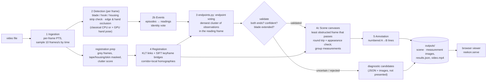

# System architecture

| Stage | Module | What it does |
|---|---|---|
| 1 Ingestion | `reekon/video.py` | Decodes with OpenCV, timestamps every frame with its presentation timestamp (checked against ffprobe) and samples by time. Cabinet-1 declares 120 fps but averages 30 fps. |
| 2 Detection | `reekon/detect.py`, `reekon/hands.py` | See the detection rules below this table. |
| 2b Events | `reekon/events.py` | An episode is continuous tape visibility in one direction; a reading is at least 0.8 s with a wide housing recognized; its blade entry can still be unobserved. For hook/housing identity, consecutive frames are linked by whether their ends keep or swap labels, and each chain's orientation is the majority vote of frames that actually saw the housing. |
| 3 Endpoints | `reekon/endpoints.py` | Votes observations into the reading frame. Hook sightings must lie on the visible tape line. Validation: both ends present, confidence ≥ 0.4, and median blade length ≥ 20% of the frame (otherwise the tape is being carried or repositioned). |
| 4 Registration | `reekon/register.py` | Lucas-Kanade tracks between consecutive samples. Scene point tracking can bridge failures with SIFT keyframes (≥ 25 inliers), up to 15 samples ahead (about 1.5 s at the default rate). Event endpoint registration uses consecutive KLT links with skips and drift refinement, without SIFT bridges. Points move by homographies fitted only to features in a corridor around the measured segment. `map_validated` adds a round trip within 2% of the diagonal, an inside-frame check, and a masked-patch NCC ≥ 0.5 at every checkable endpoint. |
| 4c Scenes | `reekon/scene.py` | Ranks nearby frames by sharpness and obstruction, maps validated measurements with `map_validated`, and greedily groups them. Falls back to the reading frame. Logs every rejection reason. |
| 5 Annotation | `reekon/annotate.py` | Numbered A→B lines. A filled marker means seen in that frame; hollow with a dashed ring means mapped there, with the ring showing spread or round-trip error. Candidates are captioned "NOT a confirmed measurement" with their reasons. |
| Viewer | `viewer/index.html`, `reekon/serve.py` | Serves only `viewer/`, `outputs/` and `results/`, with HTTP Range support (Safari needs it for video). |

Detection rules (stage 2), in the order they apply:
- **Find the tape:** look for a dark strip relative to the frame's brightness and grow the blade along its line. The width profile along the line separates the narrow blade from the wide housing.
- **Strip check:** keep it only if it is darker than the surface on both sides over at least 40% of its length, and has at least 0.9 bright/dark tick alternations per blade width.
- **Hook visibility heuristic:** the blade must not run into the frame edge (more than 1.1 blade widths along the blade), and the area beyond the end must not be mostly skin or sleeve. Over-exposed hands can evade this check.
- **Housing entry:** retain the longest wide run for housing identity, select its innermost supported entry fragment, and require local blade-side contrast. Unsupported entries are not visible and cannot vote in endpoint consensus or be selected as observed reference-frame entries.

## Design choices, and why

- **Classical CV first, no training.** The blade is a long, straight, dark strip with bright ticks, attached to a wider housing. That's a strong geometric signal, and there are no labelled tape videos.
- **Measured thresholds, not guessed ones.** The strip check and the frame-edge rule were set from true and false detections on 24 frames from all four videos. The appearance threshold was set from correct mappings (NCC 0.97–1.0) against wrong-depth mappings (0.20–0.31). The margins are thin, and the code comments record them.
- **One homography can't cover several depths.** Each link's transform is fitted near the measured object, and appearance is checked afterwards. The round trip alone was not enough: it passed a consistently wrong mapping.
- **Never present a guess as a measurement.** Endpoints are `observed`, `registered` or `missing`. Events are `validated`, `uncertain` or `rejected`, and reasons are kept. Unreliable transforms fall back to the reading frame.

## Responsibilities and interfaces

- `video.py` owns decoding and presentation timestamps; `detect.py` and optional `hands.py`
  produce `TapeObservation` records in original image pixels.
- `events.py` splits episodes/readings, enforces endpoint identity, selects a reading frame,
  merges duplicate readings and classifies events. It composes `EndpointLocalizer` from
  `endpoints.py` for consensus and straight-blade correction. `EndpointEstimate` and
  `mode_cluster` remain importable from `events` for existing callers.
- `register.py` owns motion estimation and validation. `register(src, dst)` returns a
  `Registration` with a full-resolution source-to-destination homography. Its identity matrix
  on failure must only be used when `ok` is true. `map_validated` returns points, a per-point
  acceptance mask, cycle errors and diagnostics. `KeyframeMatcher.map_validated` returns a
  single acceptance boolean for direct clean-view matches; these interfaces intentionally differ.
- `labels.py` adds direction and relative position labels using validated mappings.
  `scene.py` then chooses reliable scene canvases. `annotate.py` renders records without changing them.
- `pipeline.py` orchestrates stages, caches sampled JPEG frames, saves checked image writes,
  records timings and serializes the existing `reekon.results/2` contract. `__main__.py` batches
  videos and merges the viewer index; `serve.py` serves the static viewer and output mounts.
- `config.py` centralizes shared widths, sampling rate, image quality, hand threshold and
  registration acceptance defaults. Formula-specific coefficients stay next to their calibration
  comments. No thresholds were changed in refinement.

## Coordinates and time

All public observations, endpoints, placements and homographies use full-resolution decoded image
pixels: origin top-left, x right, y down. Registration internally rescales images and explicitly
converts transforms back. A measurement's endpoint coordinates belong to `canvas_frame`, not the
frame at `start_t`. Scene placements belong to their scene frame. A context mosaic adds a rendering
translation without changing JSON endpoint coordinates. Viewer overlays show final endpoints only
near their reference timestamp; per-frame detections use their own timestamps.

Frame indices refer to full decode order. Seconds come from decoder presentation timestamps,
clamped to zero for a negative first timestamp; never derive them from header FPS. Duration is
estimated as last PTS plus the average frame interval. The sampler uses a 1e-6-second boundary
tolerance and skips ahead after large gaps. Accurate PTS support is an assumption of the OpenCV
FFmpeg backend; no fallback to nominal FPS is introduced. Labels assume a roughly upright camera.

## Repository boundaries and provenance

| Directory | Responsibility |
|---|---|
| `reekon/` | Production measurement pipeline and local serving; no `cvbench` or Torch imports |
| `cvbench/` | Independent seeded RGB resize/grayscale/blur CPU/CUDA experiment; not detection accuracy |
| `tools/` | Inspection, live hand display and an unrun YOLO experiment; optional imports stay local |
| `viewer/` | Static HTML/CSS/JavaScript using output JSON, no build tool or external framework |
| `tests/` | Synthetic geometry, timing, registration, rendering, server and failure tests; opt-in footage and CUDA parity |
| `outputs/` | Original ten-video evaluation with 14 indexed classical/hand-assisted runs; `accuracy-final/` separately preserves ten final classical runs and 12 algorithm-validated measurements |
| `results/` | Historical benchmark reports, source hashes and environment diagnostics |
| `docs/` | Architecture, environment, evaluation, benchmark methodology and refinement verification |
| `data/inbox/`, `data/outbox/` | Ignored raw footage and exploratory work; not versioned evidence |

The inspector retains its original sampling loop: unlike production it collects full images and
uses a different scheduling rule. The live display's saved video is constant-rate and is not a
measurement timestamp source. These tools must not silently replace production ingestion.

Saved results contain creation times, software versions, configuration, frame evidence and stage
logs. Benchmark reports additionally contain source hashes and Git state. Outputs span historical
pipeline revisions: the original Deck-1, Deck-2 and Kitchen Sink runs predate labels; final runs
use the existing labeler. Preserve these facts instead of
backfilling fields or claiming every output was generated by the current revision. Regeneration
should use a new `--out` directory when preserving evidence; normal processing replaces images
and JSON for its selected video/strategy.
